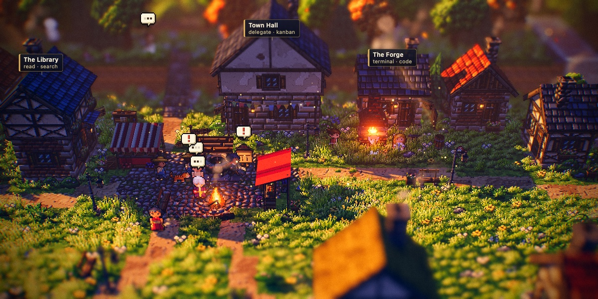
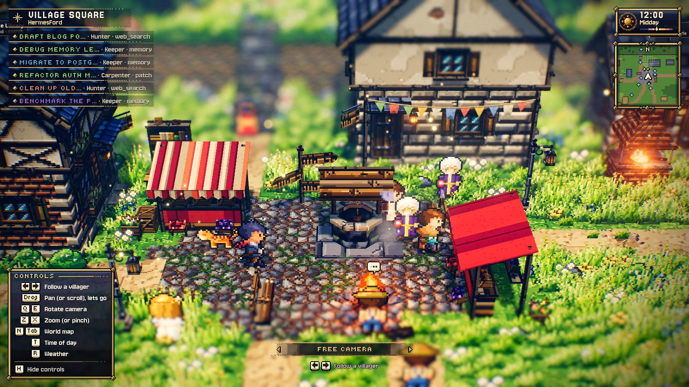
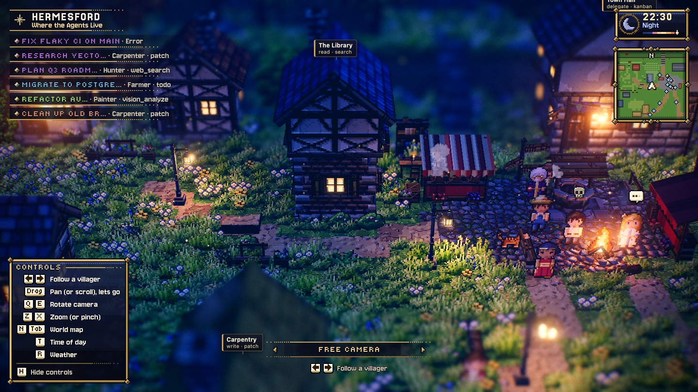
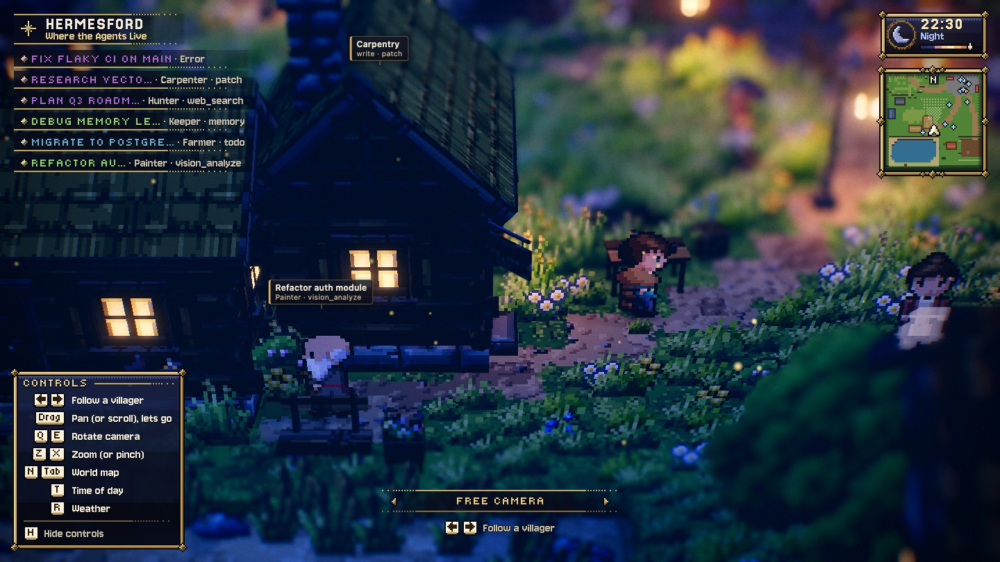
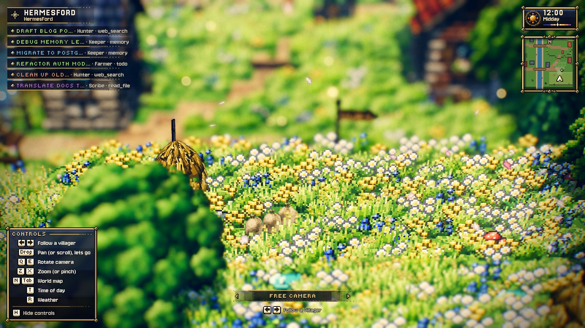

# HermesFord — Where the Agents Live

A living HD-2D pixel-art village for [Hermes Desktop](https://hermes-agent.nousresearch.com/).
Every Hermes chat is a villager. Open the **HermesFord** page from the sidebar to see at a glance
who is working, who is waiting for you, who failed and who is asleep.



It is an **indicator, not a game**. The villagers only act out what the agents really do: no
fake work and no controls except the camera. Clicking a villager opens its chat.

| | |
| --- | --- |
|  |  |
|  |  |

## What the villagers do

The plugin polls `session.active_list` / `session.list` and listens to `tool.*` / `message.*`
gateway events, then maps each chat to a state:

| Chat state | Villager |
| --- | --- |
| Waiting for you (approval, clarify) | goes to the Town Hall, a pulsing **!** over its head |
| Turn failed | a skull over its head for a few seconds |
| Running a tool | walks to the workplace for that tool and works there (see below) |
| Thinking (turn running, no tool) | sits by the campfire, **…** over its head |
| Idle | wanders around the square |
| Not active | goes home; **zzz** over the roof, the window lit at night |

| Tools | Trade | Place |
| --- | --- | --- |
| `terminal`, `execute_code`, `process*` | Blacksmith (the forge sparks while they work) | The Forge |
| `web_search`, `web_extract`, `browser*`, `mcp__tavily*`, `mcp__scrapling*` | Hunter | the woods (boars, slimes, bats at night) |
| `read_file`, `search_files`, `session_search` | Scribe | The Library |
| `write_file`, `patch` | Carpenter | Carpentry |
| `delegate_task`, `kanban*` | Messenger | Town Hall |
| `memory`, `fact_store`, `skill*` | Keeper | the well |
| `vision_analyze`, `image_generate`, `computer_use` | Painter | the lake |
| anything else | Farmer | the field |

Other features:

- Party frames (top left) list the awake chats. Click one to open its chat.
- **Follow a villager** (◀ ▶ at the bottom) makes the camera follow one chat.
- The time of day and lighting follow your real clock. The page also has a minimap and a world
  map (Tab).
- Drag to pan, scroll or pinch to zoom, Q/E to rotate.
- Rendering pauses when the page is hidden.

## Installation

Requires **Hermes Desktop ≥ 0.22.5** and WebGL.

**From Git (CLI):**

```bash
hermes plugins install XpycT/hermesford
hermes plugins enable hermesford
```

**From Hermes Desktop:** Capabilities → Plugins → **Install from Git**, enter `XpycT/hermesford`,
then switch the plugin on. You can also use the one-click link
`hermes://plugin/install?repo=XpycT/hermesford&enable=1`.

After that, **HermesFord** appears in the sidebar and opens the `/village` page.

**Manual:** copy `desktop/plugin.js` to `~/.hermes/desktop-plugins/hermesford/plugin.js` and turn
it on under Capabilities → Plugins.

## What it does and does not do (disclosure)

- **Desktop-only.** `desktop/plugin.js` runs inside the plugin SDK surface. It registers no agent
  tools, hooks, middleware or env vars.
- **Reads** the session list and live session status through `host.request('session.list')` /
  `session.active_list`, polled every 3 s, and gateway `tool.*` / `message.*` events. It never
  writes to sessions. A click only calls `host.openSession`.
- **No network calls**, no telemetry, no stored credentials. Nothing is persisted: the village
  state lives in memory.
- **Bundled code:** the whole bundle is built from this repository (≈2 MB minified). It contains
  [three.js](https://threejs.org/) (MIT) and the Luminati engine (MIT, see below). All art
  (sprites, textures, UI, fonts' pixel styling) is generated procedurally at runtime; there are
  no binary assets.
- `hermes plugins validate` passes. Its `caution` findings come from the bundled engine:
  `invisible_unicode` is CJK and typographic characters in Luminati's strings and fonts, and
  `inline_shell_exec` is a backtick-quoted melody notation in a code comment.

## Credits

HermesFord is built on **[Luminati](https://gitlab.com/stubborn-hug/lumina)** — an open-source
2.5D pixel-art engine for three.js inspired by Square Enix's HD-2D games (MIT, © 2026 Luminati).
The world, lighting, post-processing, villagers, critters, monster sprites, pathfinding (`Nav`) and
the pixel-art UI are Luminati's. A snapshot lives unmodified in `vendor/lumina/` with its
`LICENSE` and `VERSION`; `tools/vendor-lumina.sh` only rewrites four imports. The village map
follows the layouts of Luminati's *Emberfall* and *Starfall Vale*.

## Development

```bash
npm install
npm run dev            # dev page with fake chats: http://127.0.0.1:5199/?hour=17
npm test               # village simulation asserts
npm run build          # → desktop/plugin.js
npm run install-local  # build and copy to ~/.hermes/desktop-plugins/hermesford/
node tools/make-village.mjs                                         # regenerate levels/village.json
node vendor/lumina/tools/check-level.mjs levels/village.json --strict # Luminati's level checker
```

| Path | What it is |
| --- | --- |
| `src/plugin.js` | registers the page and the sidebar entry; Hermes data → villagers |
| `src/viewer.js` | hosts the Luminati level: engine, light, post-FX, villagers, critters, UI |
| `src/village.js` | the pure simulation: chat state → where to go and what to do |
| `tools/make-village.mjs` | generates the map `levels/village.json` |
| `desktop/plugin.js` | the built plugin (committed: it is what Hermes installs) |

Dev-page query params: `?hour=N` (time of day), `?fake=0` (no fake events), `?panel=0` (hide the
event panel).

## License

[MIT](LICENSE). Luminati is MIT-licensed by its authors (`vendor/lumina/LICENSE`).
